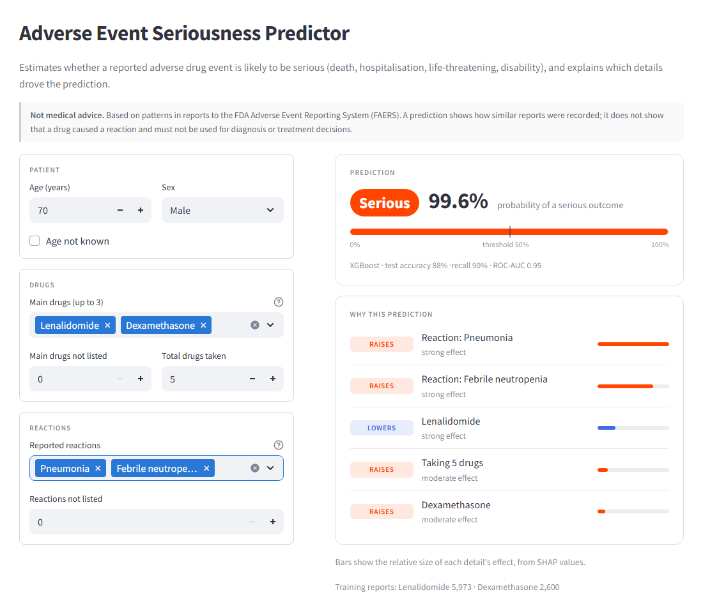
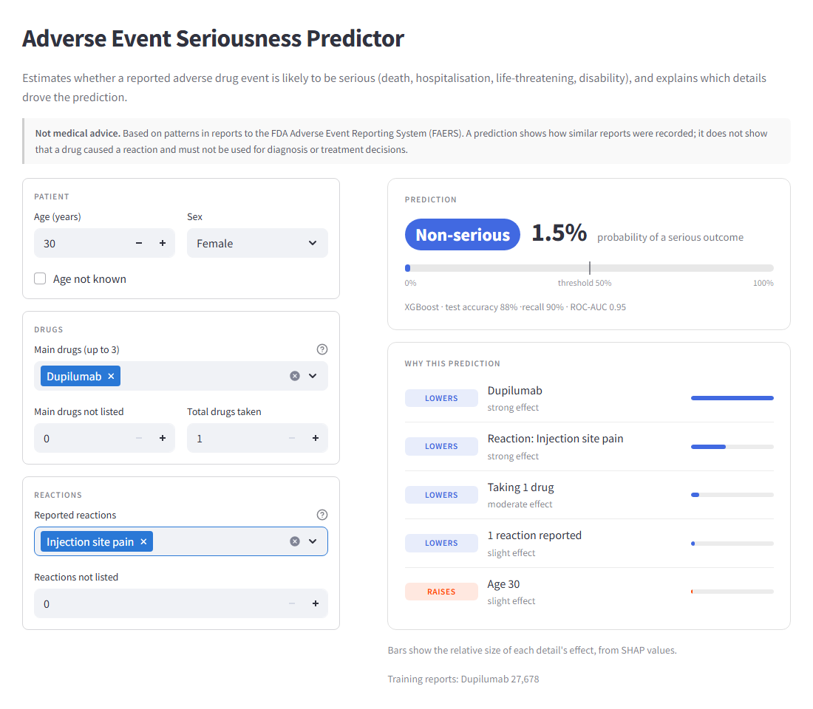
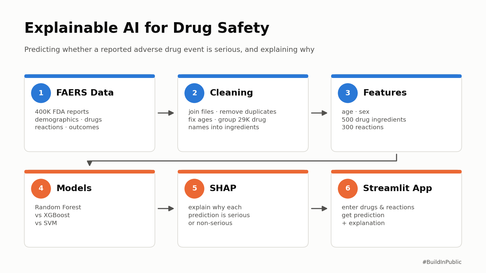
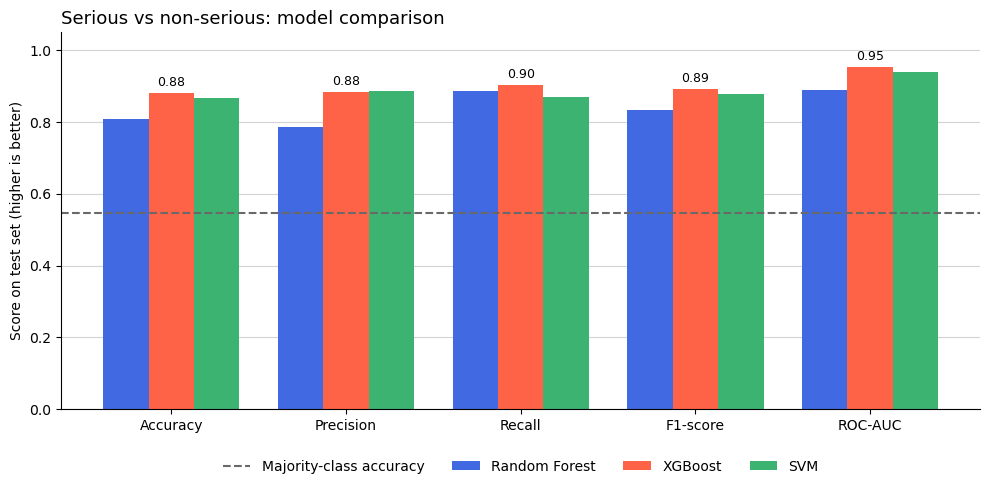
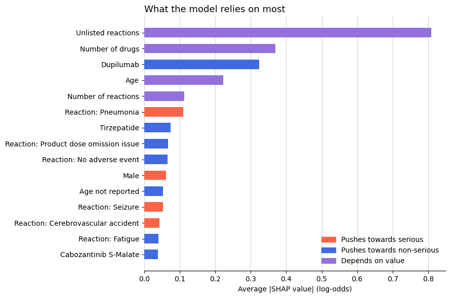
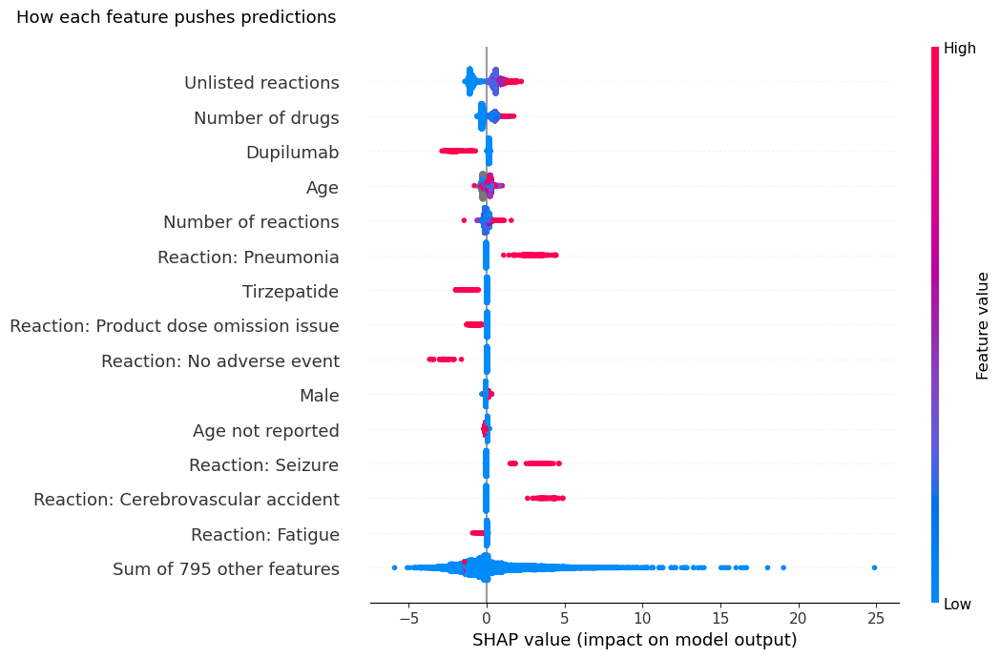

# AI-Based Adverse Drug Reaction Prediction System

Predicts whether a reported adverse drug event is **serious** (death, hospitalisation, life-threatening, disability) or **non-serious**,
using FDA FAERS reports, machine learning and SHAP explanations, with a Streamlit app that explains every prediction.

**Author:** Krish Sharma

> **Not medical advice.** Predictions describe patterns in FAERS *reports*; they do not show that a drug caused a reaction.

---

## The app

Enter a patient's age, sex, drugs and reported reactions. The app shows whether the event is likely serious, the probability,
and the details that pushed the prediction up or down.

**Serious:** cancer treatment with pneumonia and febrile neutropenia, 99.6%



**Non-serious:** eczema injection (dupilumab) with injection site pain, 1.5%



---

## How it works



1. **Data_Prep:** joins FAERS 2025 Q1 files, removes duplicates, groups drugs by ingredient, builds the serious target
2. **Feature_Engineering:** 80/20 split, 809 features (age, sex, 500 ingredients, 300 reactions, counts)
3. **Model_Training:** Random Forest, XGBoost and SVM, best chosen on a validation set
4. **Explainability:** SHAP values for the selected model
5. **app/app.py:** the Streamlit app

**Leakage check:** reaction terms that restate the outcome (*Death*, *Hospitalisation*) are removed from the inputs,
and the 13,737 reports that listed only those terms are dropped.

---

## Results

Test set: 77,356 reports the models never saw.

| Model | Accuracy | Precision | Recall | F1-score | ROC-AUC |
|---|---|---|---|---|---|
| Majority class (baseline) | 0.546 | 0.546 | 1.000 | 0.707 | 0.500 |
| Random Forest | 0.807 | 0.786 | 0.887 | 0.834 | 0.890 |
| **XGBoost (selected)** | **0.881** | 0.883 | **0.902** | **0.892** | **0.953** |
| SVM (linear) | 0.868 | **0.887** | 0.869 | 0.878 | 0.939 |

XGBoost catches **90% of serious reports** (38,110 of 42,262) with 88% precision.



### What drives the predictions (SHAP)





- Serious medical reactions (pneumonia, sepsis, seizure, kidney injury) push towards **serious**.
- Product and device issues push towards **non-serious**.
- Reports with more drugs or reactions are more often serious.

---

## Run it

Needs Python 3.12 or newer.

```bash
pip install -r requirements.txt
```

1. Download the **ASCII** zip for **2025 Q1** from the [FDA FAERS page](https://fis.fda.gov/extensions/FPD-QDE-FAERS/FPD-QDE-FAERS.html).
   Convert the `$`-separated DEMO, DRUG, REAC and OUTC files to CSV (`demo2025q1.csv`, `drug2025q1.csv`, ...)
   in `data/raw/2025Q1/`, and copy `DELETE25Q1.txt` there as `delete2025q1.txt`.
2. Run the notebooks in order: `Data_Prep` → `Feature_Engineering` → `Model_Training` → `Explainability`.
3. Start the app:

```bash
streamlit run app/app.py
```

## Tech stack

Pandas · NumPy · scikit-learn · XGBoost · SHAP · Matplotlib · Streamlit

## License

MIT. See [LICENSE](LICENSE).
